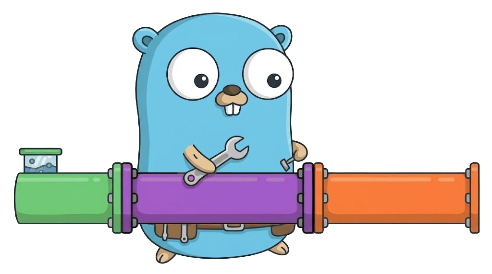

# go-monad

Functional programming basic monads and collections for golang

## Project Status
This project is not yet intended for production use.
Expect big changes in the API and the features present.